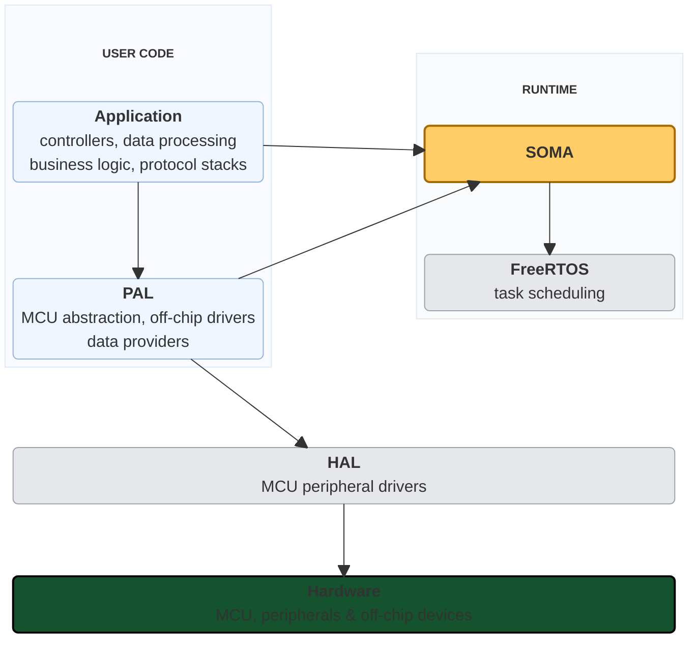

<p align="center">
  
</p>

# S.O.M.A. Framework - Scalable Object-oriented Microcontroller Applications

> **C++17** framework library based on top of **FreeRTOS** scheduler that shifts old-style C task loop focused design towards the object-oriented task-agnostic **active components**. The designer does not need to think in terms of tasks but instead, models features by classes that react to external events, timers and other components in the context of a provided task.

What is unique on this approach?
- **[reactor design pattern](https://en.wikipedia.org/wiki/Reactor_pattern)** implemented using a statically allocated **task pool**
- RTOS tasks do not implement any specific feature, they only provide run-time context
- active components are **task agnostic**, they just leverage their run-time context
- multiple active components can **share the same task context**
- active component objects leveraging the same task context are **not aware of each other**
- assigning context and priorities to active components is isolated from the design itself

Simply, model a sensor, controller, or communication service as an active component with its own state, timers, event handlers, queues etc. Compose the components into application objects, assign them task contexts and choose which application to construct and launch at run-time.

## Motivation

- **object oriented design**
- **streamline firmware architecture**
- **abandon C language and common OOP simulation patterns**
- **eliminate pointers as much as possible (references, iterators, data views - Array, Buffer_view, String_view etc.)**
- **increase memory safety**
- **eliminate common multi-threading issues**
- **more focus on business logic**
- **binding independent and re-usable components at construction time**
- **typesafe logging**
- **improve scalability and re-usability**
- **long term suistainability, extensibility and portability**
- **multi-application firmware image with run-time switching capability (w/o using heap)**
- **automatic task monitoring (for WDT)**
- **no STD dependency or knowledge required**

## Features
- typesafe containers and memory views
- typesafe, in-memory logging using streaming operators (working in ISR for debug purposes)
- text/string abstraction
- static memory allocation only (no heap used by the framework)
- heap provided in cases it is required by the application
- run-time object discovery
- support for multi-application design
- object observability
- active component local events, timers
- generic I/O streams
- application abstraction and hierarchy
- traditional loop-based tasks supported
- unit test environment (backed by Google Test framework with FreeRTOS Windows port)
- smart variables (overridable, observable, bounded)

## Library areas

| Area | What you can add |
| --- | --- |
| [Containers](include/soma/containers) | Fixed-capacity buffers, ring buffers, memory pools, SPSC and MPSC queues. |
| [Variables](include/soma/variables) | Observable values, bounds, and runtime overrides. |
| [Runtime](include/soma/runtime) | Tasks, timers, events, mutexes, semaphores, and signals. |
| [I/O](include/soma/io) | Blocking and buffered streams, plus queue adapters. |
| [Text](include/soma/text) | Strings, views, parsing, and formatting. |
| [Diagnostics](include/soma/diagnostics) | Logging, memory profiling, and task profiling. |

## License

SOMA's original code is available under the [MIT License](LICENSE).
Dependency licenses are listed in [Third-Party Notices](THIRD_PARTY_NOTICES).

## Intended Firmware Architecture



### Application
- main container of all the active components
- the application class inheritance allows to create any number of application layers (e.g. common, main etc.)
- multiple independent applications (sharing the same board) can be defined in the same image (e.g. board revision detector,
  factory test, main application etc.)
- decission about which will be instantiated can be made at run-time (e.g. based on a discrete input state etc.)
- statically allocated using Application_factory (leveraging std::variant)
- stays independent of the board coponents (MCU, off-chip devices etc.)

### PAL (Platform Abstraction Layer)
- separates business logic from the MCU and board specifics
- modeled as a container class that the application container inherits from
- provides all the board features to the application layer (in an abstracted form)
- defines platform specifics like task pool stack sizes, log size
- adapts application to multiple board revisions (e.g. different board revisions could provide different ADC chips)

## Usage

- [Active component using events and timers](#active-component-using-events-and-timers)
- [Shared tasks and priorities](#shared-tasks-and-priorities)
- [Observable values and events](#observable-values-and-events)
- [Bounds and runtime overrides](#bounds-and-runtime-overrides)
- [Containers and memory views](#containers-and-memory-views)
- [Queues and signals](#queues-and-signals)
- [Fixed-size memory pools](#fixed-size-memory-pools)
- [Strings and text](#strings-and-text)
- [Generic I/O streams](#generic-io-streams)
- [Type-safe logging](#type-safe-logging)
- [Object discovery and diagnostics](#object-discovery-and-diagnostics)
- [Applications and hierarchy](#applications-and-hierarchy)
- [Existing task loops and synchronization](#existing-task-loops-and-synchronization)
- [Optional application heap](#optional-application-heap)
- [Configuration](#configuration)
- [Testing](#testing)

### Active component using events and timers

A class receives its execution context instead of owning a task loop. [Timers](include/soma/runtime/task_timer.h) and [startup callbacks](include/soma/runtime/task_startup_event.h) run on that task.

```cpp
class Heartbeat
{
public:
    explicit Heartbeat(Event_task& task)
        : m_timer(task, *this, &Heartbeat::tick),
          m_startup(task, *this, &Heartbeat::start) {}

private:
    Task_timer<Heartbeat> m_timer;
    Task_startup_event<Heartbeat> m_startup;

    void on_startup() { m_timer.start_periodic(1000u); }
    void on_timeout() { ILOG << "Alive"; }
};
```
### Shared tasks and priorities

Assign contexts at construction; component implementations stay unchanged. [Task memory](include/soma/runtime/task_memory.h) is static, with stack capacity specified in bytes.

```cpp
Task_memory<2048u> worker_memory;
Event_task worker { "worker", Task::Priority_e::normal, worker_memory };

Heartbeat status { worker };
Heartbeat telemetry { worker }; // Independent components, shared task.

Task_memory<2048u> urgent_memory;

Event_task urgent { "urgent", Task::Priority_e::high, urgent_memory };
Heartbeat watchdog_signal { urgent }; // Same class, different priority.
```

### Observable values and events

[Variables](include/soma/variables/variable.h) publish typed state and notify only on changes.

```cpp
Variable<int> temperature { 20 };

temperature = 25;
int latest = temperature
```

Inside a consumer component, choose where its callback runs:

```cpp
Task_event<Controller> changed {
    task, temperature, *this, &Controller::on_update
}; // Marshalls to the assigned task.
```

```cpp
Variable_observer_handler<Controller> changed {
    temperature, *this, &Controller::async_on_update
}; // Immediate, in the writer's context.
```

[Task_event](include/soma/runtime/task_event.h) on-change notifications can coalesce. Use async observer and a queue to retain every item.

### Bounds and runtime overrides

Clamp settings with [Bounded_variable](include/soma/variables/bounded_variable.h); inject test values with [Overridable_variable](include/soma/variables/overridable_variable.h).

```cpp
Bounded_variable<int> target { 22, 5, 30 };
target = 50; // Clamped to 30.

Overridable_variable<int> input { 20 };

input.set_override(10);  // Consumers see 10.
input = 24;              // Owner's latest value is remembered.
input.clear_override();  // Consumers now see 24.
```

[Overridable_bounded_variable](include/soma/variables/overridable_bounded_variable.h) combines both. Override callbacks must be short, nonblocking, and must not write back to the same variable.

### Containers and memory views

`<T, N>` owns fixed storage; `<T>` views caller-owned storage. [Array](include/soma/array.h), [Buffer](include/soma/containers/buffer.h), and [Buffer_view](include/soma/containers/buffer_view.h) preserve element types and check bounds.

```cpp
Array<uint8_t, 4u> data { 1, 2, 3, 4 };     // view + storage
Array<uint8_t> writable { data };           // view
Array<const uint8_t> read_only { data };    // view

auto header = read_only.sub_array(0u, 2u);  // view

Buffer<uint8_t, 16u> packet;             // Capacity 16, initially empty.

bool inserted = packet.insert(0x42);
Buffer_view<uint8_t> payload = packet.view_items(); // Read-only items.
```

Views must not outlive their storage. Check insert/transfer results when capacity can be exhausted.

### Queues and signals

Transfer samples between tasks without sharing mutable component state.

```cpp
Queue_SPSC<int, 16u> samples { "samples" };

if (samples.push(25) == false) // Producer.
{
    ELOG << "Queue full";
}

int sample;

while (samples.pop(sample)) // Consumer: drain all available items.
{
  ILOG << sample;
}
```

| Type | Use |
| --- | --- |
| [Ring_buffer](include/soma/containers/ring_buffer.h) | Lock-free. One producer, one consumer; `insert` / `remove`. |
| [Queue_SPSC](include/soma/containers/queue_spsc.h) | Lock-free. Zero-copy. One producer, one consumer. Observable for item/space signals. |
| [Queue_MPSC](include/soma/containers/queue_mpsc.h) | Thread-safe. Multiple producers, one consumer. |

Bind a consumer's `Task_event` to `samples.signal_items_available()` and drain on startup and notification. For zero-copy SPSC access, use `get_space()` / `place(count)` and `view_items()` / `displace(count)`; ring wrap may require multiple chunks.

```cpp
Signal button_pressed;

button_pressed.emit(); // Observe through Task_event to marshal handling to component's context.
```

[Signals](include/soma/runtime/signal.h) carry no payload. ISR producers must use FreeRTOS-compatible interrupt priorities; direct observers run in the emitter's context.

### Fixed-size memory pools

Allocate blocks without a heap. [Memory_pool](include/soma/containers/memory_pool.h) needs caller synchronization when shared.

```cpp
Memory_pool<uint8_t, 256u> pool { 32u }; // Eight 32-byte blocks.

if (auto* block = pool.allocate())
{
    pool.deallocate(block);
}
```

### Strings and text

[Strings](include/soma/text/string.h) and [formatting](include/soma/text/text_string_output.h) use bounded storage; [views](include/soma/text/string_view.h) avoid copies.

```cpp
String::Length<48u> message;
Text_string_output output { message };

output << "Temperature: " << 25 << " C";
String_view text = message.view();
```

Zero-copy [parse](include/soma/text/text_string_input.h) directly from a view:

```cpp
String_view command { "target 22" };
Text_string_input input { command };
String_view key;

int value {};
if (input >> key >> value)
{
    ILOG << key << " = " << value " = 0x" << hex << value;
}
```

Strings truncate at capacity; views must not outlive their source. [Text_output](include/soma/text/text_output.h) also supports `hex`, `precision(n)`, `bytes(n)`, and `memory_dump(view)` modifiers.

### Generic I/O streams

Board adapters implement [I_input_stream](include/soma/io/i_input_stream.h) / [I_output_stream](include/soma/io/i_output_stream.h). Add blocking text I/O without changing the driver:

```cpp
Blocking_input_stream rx { uart_rx };
Blocking_output_stream tx { uart_tx };

Text_input input { rx };
Text_output output { tx };

output << "Ready" << EOL;
```

Blocking adapters belong on a task that may wait.

**Asynchronous input** inside a `Receiver` component:

```cpp
Buffer<uint8_t, 64u> received;
Task_event<Receiver> rx_done { task, uart_rx, *this, &Receiver::on_read };

void read()
{
    received.clear();

    if (uart_rx.read(received) == I_input_stream::Result_e::ready)
    {
        on_read();
    }
    else
    {
      // rx_done dispatches completion on task.
    }
}

void on_read()
{
    ILOG << "Received " << received.size() << " bytes";
}
```

**Asynchronous output** inside a `Sender` component:

```cpp
Buffer<uint8_t, 4u> outgoing { 1, 2, 3, 4 };
Task_event<Sender> tx_done { task, uart_tx, *this, &Sender::on_written };

void send()
{
    auto result = uart_tx.write( outgoing.view_items() );

    if (result == I_output_stream::Result_e::ready)
    {
        on_written();
    }
    else if (result == I_output_stream::Result_e::unavailable)
    {
        ELOG << "Output unavailable";
    }
    else
    {
      // wait: tx_done dispatches completion on task.
    }
}

void on_written()
{
    ILOG << "Sent";
}
```

Start transfers from the component's task, one at a time per stream. Keep buffers alive and unchanged while pending; `uart_rx.cancel_read()` ends a pending read. Input notifications can also report unavailability with no data.

Drain a queue asynchronously on an assigned task:

```cpp
Queue_SPSC<uint8_t, 256u> pending { "tx" };

Output_stream_queue_consumer<uint8_t> sender {
    task, pending, uart_tx, 5u, 64u
}; // Batch for 5 ms; write up to 64 bytes at a time.
```

[Output_stream_queue_consumer](include/soma/io/output_stream_queue_consumer.h) discards unavailable output by default; select `Unavailable_policy_e::retain` and call `resume()` after reconnect to retry. [Buffered input](include/soma/io/buffered_input_stream.h) and [buffered output](include/soma/io/buffered_output_stream.h) add ring storage.

### Type-safe logging

[Log](include/soma/diagnostics/log.h) stores messages in RAM; [Log_streamer](include/soma/diagnostics/log_streamer.h) drains them independently.

```cpp
Array<char, 4096u> storage;
Log log { storage };
Log_streamer sender { task, log, 20u, uart_tx };

log.expose(); // once exposed, globally available logging macros (DLOG, ILOG, ELOG) are ready to use

ILOG << "Temperature: " << 25 << " C";
ELOG << "Sensor unavailable";
DLOG << "Samples: " << 42u;
```

Define `SOMA_CONFIG_ENABLE_DLOG` on top of the source file to enable `DLOG`. Logging is thread-safe and supports FreeRTOS-compatible ISRs; messages are bounded by `SOMA_CONFIG_MAX_LOG_MESSAGE_LENGTH` and use caller stack space.

### Object discovery and diagnostics

[Enumerate](include/soma/i_object_enumerator.h) objects without maintaining a registry:

```cpp
for (Task& task : Task::objects())
{
    ILOG << task.name();
}

Overridable_variable<int32_t> temperature_degC {25, "temperature"};
Overridable_variable<float> pressure_Pa {101, "pressure"};

if (auto* value = B_variable::find_object("temperature"))
{
    value->set_override(String_view { "70" });
}
```

Named lookup requires `SOMA_CONFIG_ENABLE_NAMED_VARIABLES` and a named variable. Tasks, variables, streams, and queue profiles register at construction.

```cpp
Task_profiler<16u, 1000u, 5u, 60u> profiler { task };
Memory_profiler memory;

profiler.to_text(output); // State, priority, CPU over 1 / 5 / 60 seconds.
memory.to_text(output);   // Heap, stack peaks, queue occupancy/peaks.
```

Construct the [task profiler](include/soma/diagnostics/task_profiler.h) before launch; read reports afterwards. [Memory profiling](include/soma/diagnostics/memory_profiler.h) discovers resources automatically. Watchdog policy and progress checks belong to firmware.

### Applications and hierarchy

[B_application](include/soma/runtime/b_application.h) inherits from PAL; derived applications add their own components.

```cpp
class Application : public B_application<PAL>
{
public:
    Application() : B_application<PAL>("main") {}
};
```

[Application_factory](include/soma/runtime/application_factory.h) holds one selected application in static storage:

```cpp
static Application_factory<Main_application, Factory_application> applications;

applications.create<Factory_application>().launch();
```

```cpp
// From an external lifecycle task, after stopping old tasks and quiescing I/O:
applications.create<Main_application>().launch(); // Replaces the previous application.
```

Constructor arguments pass through `create<T>(args...)`. `launch()` starts registered tasks; the factory destroys the previous application on replacement.

### Existing task loops and synchronization

[Task](include/soma/runtime/task.h) also supports traditional loops. Override `loop()` in your task class:

```cpp
void loop() override
{
    for (;;)
    {
        ILOG << "Polling";
        sleep_period(100u);
    }
}
```

[Mutex_guard](include/soma/runtime/mutex_guard.h) releases a shared mutex automatically:

```cpp
{
    Mutex_guard lock { bus_mutex, 10u }; // RAII

    // lock acquired

    ILOG << "Exclusive access";
}
```

[Semaphores](include/soma/runtime/semaphore.h) count resources; [Synchronization_semaphore](include/soma/runtime/synchronization_semaphore.h) provides `signal()` / `wait()` for completion. [Critical_section_guard](include/soma/runtime/critical_section.h) protects short, nonblocking interrupt-sensitive work.

### Optional application heap

The framework uses supplied storage. Enable a heap only when application code needs dynamic allocation:

```cpp
static Array<uint8_t, 16384u> heap_storage;
static const Array heap_regions { heap_storage };

run(startup, startup_memory, heap_regions);
```

[run(startup, startup_memory)](include/soma/runtime/run.h) disables heap use. `SOMA_CONFIG_OVERRIDE_GLOBAL_NEW_DELETE` routes C++ allocation through the configured heap; initialize it before any allocation.

### Configuration

In your `CMakeLists.txt`, after defining the `application` target (CMake 3.23+):

```cmake
add_library(soma_config INTERFACE)
target_include_directories(soma_config INTERFACE ${CMAKE_CURRENT_SOURCE_DIR}/config)

set(FREERTOS_PORT GCC_ARM_CM4F) # Select your MCU's FreeRTOS port.
add_subdirectory(third_party/soma)

target_compile_features(application PRIVATE cxx_std_17)
target_link_libraries(application PRIVATE SOMA::soma)
```

Copy [soma_config.example.h](dev/soma_config.example.h) to `config/soma_config.h` and fill in board settings. SOMA supplies `FreeRTOSConfig.h`.

### Testing

Create a separate Windows/MinGW host build in your project's `test/CMakeLists.txt`:

```cmake
cmake_minimum_required(VERSION 3.23)

project(application_tests LANGUAGES C CXX)

set(CMAKE_CXX_STANDARD 17)
set(CMAKE_CXX_STANDARD_REQUIRED ON)

enable_testing()

add_subdirectory(../third_party/soma/test_fixture soma_test_fixture)

add_executable(application_tests test_controller.cpp ../src/controller.cpp)

target_include_directories(application_tests PRIVATE ../include)
target_link_libraries(application_tests PRIVATE soma_test_fixture)

add_test(NAME application_tests COMMAND application_tests)
```

Example `test/test_controller.cpp` for an application-owned `Controller` with a `heating_required(current, target)` method:

```cpp
#include "test_common.h"
#include "controller.h" // Component under test.

TEST(Controller, HeatingFollowsTarget)
{
    Controller controller;

    EXPECT_TRUE(controller.heating_required(18, 22));
    EXPECT_FALSE(controller.heating_required(25, 22));
}
```

```sh
cmake -DCMAKE_BUILD_TYPE=Debug -S test -B build/test
cmake --build build/test

ctest --test-dir build/test --output-on-failure
```

The [test fixture](test_fixture/CMakeLists.txt) supplies `main()`, Google Test/Mock, the Windows FreeRTOS port, and host configuration. Tests run inside FreeRTOS with task/heap leak checks. Stop test-owned tasks before destroying their components. See SOMA's [own tests](test) for asynchronous examples.
